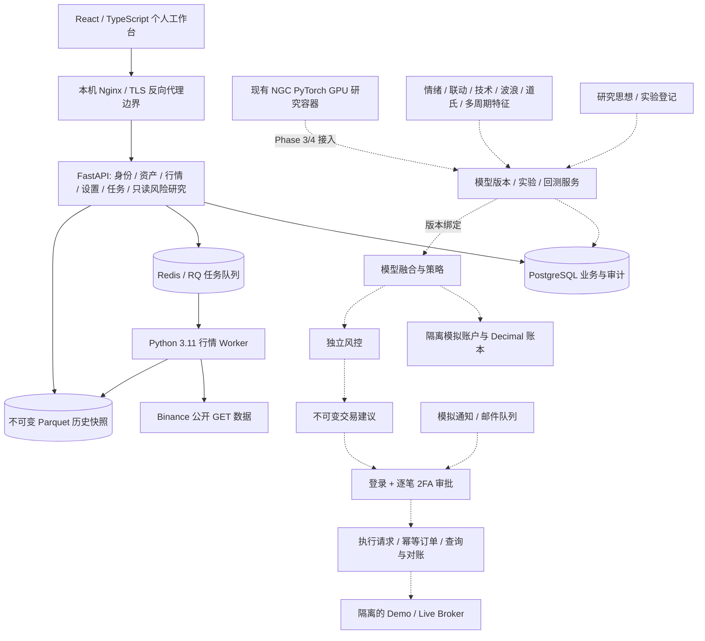

# Global Quant AI V2.0 — 系统架构

本架构覆盖全部八个阶段；Phase 1 已实现。Phase 2 已落地按需三年历史归档和基于本地缓存的多周期结构API/图表叠加；5秒刷新、整体情绪汇总和多个持久模拟账户仍在开发。既有离线模型研究不等于已经完成 Web 模型中心或模拟账户。

实线是 Phase 1 已实现的数据通路；虚线为后续设计。Phase 1 没有 Broker 订单实现，订单 API 在后端拒绝。

## 技术选型

| 组件 | 选择 | 原因与边界 |
|---|---|---|
| Web | React 19 + TypeScript + Vite 6.4 | 桌面优先、响应式、深色工作台；npm 锁文件 |
| 图表 | Apache ECharts 6.1（Apache-2.0） | 蜡烛、量柱、MA、十字线、缩放；仅显示已收盘实际数据 |
| API | Python 3.11 / FastAPI / Pydantic | 同源 REST；未来需要时添加 WebSocket，不将轮询声称为 WebSocket |
| ORM / 迁移 | SQLAlchemy 2.1 / Alembic | 业务与迁移分离，首版迁移冻结表定义 |
| 数据库 | PostgreSQL 15 | 持久业务、外键、事务；未来账本 NUMERIC(38,18) |
| 任务 | Redis 6 + RQ 2 | AOF、独立 Worker、持久任务状态、失败最多3次；采集分页检查点 |
| 历史数据 | Arrow Decimal128 + Parquet/Zstd | 不可变文件 + SHA256 + DB 指针；数据库不存大批重复 OHLC |
| 身份 | Argon2id + 12小时服务端会话 | 随机令牌只存 SHA256，HttpOnly / SameSite，CSRF、来源校验与限流 |
| GPU | 现有 NGC PyTorch 25.11 容器 | 保留 GB10/CUDA 环境；该镜像没有 TensorFlow；研究 Python3.12 与新 API3.11 隔离 |
| 部署 | Docker Compose | web/api/worker/postgres/redis，与原 lab 共存；只发布127.0.0.1:8080 |

相关实现依据：[FastAPI Cookie](https://fastapi.tiangolo.com/advanced/response-cookies/)、[SQLAlchemy PostgreSQL/psycopg](https://docs.sqlalchemy.org/en/20/dialects/postgresql.html#module-sqlalchemy.dialects.postgresql.psycopg)、[RQ Worker](https://python-rq.org/docs/workers/)、[ECharts](https://echarts.apache.org/en/index.html)。

## 模块边界与后续服务

- Asset Registry：唯一产品ID、底层资产ID、供应商别名、多主题归属；股票与ETF、杠杆ETF、商品期货、相关永续、未上市相关合约不可混用。
- Ingestion：公开 GET、来源核验、上市时间、交易日历、原生周期、清洗与分页恢复。无可信来源的全球资产只登记，行情显示缺失。
- Sentiment / Contagion（Phase3）：各源有时间戳与缺失状态；0–100风险分、六类风险状态；无数据为UNKNOWN。联动统计区分相关、领先滞后与因果假设。
- Technical（Phase2）：统一研究域结构报告与已认证`GET /api/market/structure`：按选定的本地归档周期分析已收盘K线，返回已确认摆动点、趋势线/破坏、Dow 1-2-3、Elliott候选与因果价格-RSI背离。事件分别保存发生/确认时间、证据和源SHA256；归档图表显示当前周期线/事件及跨周期破坏状态。缺少周期明确报告缺档；分析请求不主动联网。
- Live market（Phase2）：三年缓存视图只刷新当前选中周期；同源认证且CSRF保护的POST触发币安公开GET，已收盘K线新分段追加，形成中K线以本机SHA256快照显示，错误时退避。当前单API进程锁序列化写入，适用于本机单服务；横向扩容前需共享节流。Python3.11后端和前端CI已通过，本机新容器运行验收待包索引可达。
- Multi-timeframe（Phase2）：仅用截至决策时刻已收盘的大周期。配置高低周期关系，不读取未来高周期收盘。
- Features / Models（Phase3）：训练集拟合预处理，时间切分与标签窗口隔离；不可变模型版本、代码/数据/特征校验、随机种子、训练产物、评估与批准状态。
- Ensemble（Phase4）：版本固定的加权、投票、层级、OOF元模型；不能在线自动替换已运行策略。
- Backtesting（Phase4）：滚动验证、一次性冻结留出集、基线/消融，手续费、滑点、资金费、精确时间与交易限制；展示净值、回撤、操作及持仓时长。
- Paper（Phase5）：独立账户、资金/仓位/订单/成交/权益/事件账本；账户与模型版本外键，Decimal、幂等，重启恢复；禁止账户共用资金。
- Risk / Approval / Execution（Phase7）：建议快照哈希、逐笔2FA、审批过期、批准后风险重查、clientOrderId唯一、未知结果先查询对账。任何模型不能调用Broker下单。
- Broker（Phase6/7）：LIVE_READONLY、BINANCE_DEMO、INTERNAL_PAPER、LIVE_APPROVAL连接独立；密钥后端加密，最小权限验证；Phase1不接受密钥。
- Notifications（Phase6）：模拟记录与真实投递严格区分；后端凭据加密、重试去重、投递状态。现有CLI模拟邮件不被冒充Web邮件服务。
- Ideas（Phase8）：研究假设→实验登记→数据/版本绑定→验证→人工晋升，支持回滚。

## API 与安全边界

Phase1 路由见 `/api/docs`：公开健康和登录握手，其余业务API要求会话。写操作同时要求CSRF，浏览器Origin必须在白名单。用户名密码错误统一响应，Redis限制每个IP/用户名5分钟10次，限流不可用则拒绝登录。密码修改撤销所有会话。登录、任务与设置变更写审计，不写密码、Cookie、密钥。

风险研究路由只读取GPU容器生成的本机版本化报告，缺少/损坏产物时返回不可用；预算试算要求会话与CSRF，使用服务端风险上限重新计算。页面展示已使用验证窗的GRU质量分、波动预算、减仓对照和数据时点，不构成实时信号，不触碰保留留出集，不调用交易所私有API、不接受私钥、不发订单。详情见[`docs/risk-research.md`](../risk-research.md)。

初始管理员密码随机生成到 `.runtime/bootstrap-admin.txt`（0600）；从不进入源码、镜像或日志。没有开放注册。`.runtime/`目录0700且数据库密码单独0600文件。此版本为本机个人部署：HTTP + loopback，`COOKIE_SECURE=false`仅适用本机；远程部署必须配置受控TLS/私网及`COOKIE_SECURE=true`、明确Origin白名单。不会自动接入现有80/443服务。

Phase1审计是应用只追加，不声称具备数据库级防篡改。Phase7前需要追加触发器/数据库权限及外部审计存档、2FA恢复流程、严格角色与订单审计测试。

未来接口定义在 `backend/app/domains/contracts.py`；这些是类型契约，不是已经可用的模型训练或交易实现。

## 数据与运行恢复

- 四个优先标的通过已验证本地真实15m快照导入；只读挂载原始数据，不改回测划分和历史结果。所有来源路径及原始 provenance 写入元数据。
- Binance公开REST的常规快照采集使用精确已登记合约代码、原生周期和最近最多90天。每页完成后更新不可变Parquet快照与事务元数据；重试从最新持久K线开始，不重复追加。
- Phase2长期归档由用户显式创建`FETCH_ARCHIVE`任务，按精确核验USDT永续和原生周期采集最多三年；分段位于`DATA_ROOT/long_history/<symbol>/<interval>/`，包含SHA256及原子manifest，与90天表和既有报告完全隔离。读取归档不会触发网络请求。在线实时刷新、结构叠加、情绪融合及模拟账户仍未完成。
- 每个资产/周期写入通过PostgreSQL事务 advisory lock 串行。新文件原子落盘后更新指针，不覆盖旧文件；异常可留下孤立文件，当前版本不自动清理，后续需要备份/保留策略。
- 聚合依据UTC边界；周线周一00:00，月线自然月。不完整/缺失桶排除并显示数量。不把大周期插值为小周期。
- 上游DNS/451/超时明确记录失败、重试次数与供应商状态，不替换域名规避限制，不伪造行情。当前任务状态每10秒轮询；三年归档需人工点击，图表尚未实现5秒行情刷新，不宣称实时盘口。
- Redis AOF保存队列；数据库记录任务与分页进度。普通异常最多3次。启动时补发未发布的QUEUED/QUEUE_ERROR任务。Worker被强杀的RUNNING任务由RQ维护及重试处理；任务页可对最终失败任务重新入队。严格跨进程 exactly-once 不作保证，数据写入幂等。
- 数据库卷与Parquet目录需一起备份，恢复后校验SHA256。不能用`down -v`重置用户数据。
