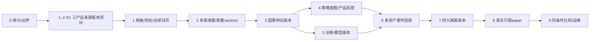

# 全球资产增量改造：阶段0审计与实施顺序

审计日期：2026-10-21；基线 `7c8c1ae`，功能分支 `feature/phase2-market-structure`。依据本次用户九阶段需求及现有代码，而非旧聊天能力描述。阶段0仅审计；随后交付下面定义的 D1 小单元。旧文档 Phase1–8 是历史路线，本文 Stage0–9 是本次依赖顺序，二者不按数字等同。

用户已授权后续隔离本地 paper 开发，不等于当前已有 paper。真实下单、开户、购买订阅、采集真实交易密钥、真实邮件不在本次范围；服务端 live 拒绝边界保留，未来实盘仍需独立风控、逐笔2FA和另一轮明确授权。

## 差距矩阵

状态含义：IMPLEMENTED 已有实际实现；PARTIAL 仅部分闭环；BLOCKED 外部条件受阻；PLANNED 未实现。下列证据行号针对审计基线，后续改动可能移动行号。

| 需求 | 现有能力 / 状态 | 证据文件 | 缺口 | 依赖 | 验收 | 预计改动范围 |
|---|---|---|---|---|---|---|
| 分包与恢复 | IMPLEMENTED 研究领域包、兼容shims、进度/任务/Git | `docs/project.md`；`quant_lab/compat.py`；`scripts/resume.sh` | 新单元需持续交接；`.local/`是既有未跟踪目录 | 无 | 旧导入/可信权重兼容；明确文件提交 | 文档、新领域模块 |
| 产品身份 | PARTIAL 静态种子87项=13永续+74其他，非旧文档80/85；底层与永续分离 | `domains/asset_catalog.py`；`config/platform/additional_assets.json`；`domains/models.py:46` | 日欧目录、BTC现货、挂牌MIC/权限未齐；目录数不等于真实覆盖 | 主数据 | 产品、场所、计价币独立；不杜撰tradable symbol | additive seed/API |
| 人工来源配置 | PARTIAL 资产只新增，来源绑定每次seed覆盖 | `services/catalog.py:51,80` | 人工来源/历史规格可被覆盖；alias无有效期 | 主数据版本 | 重启保留人工binding，别名和版本不冲突 | catalog、定向测试 |
| 长历史 | PARTIAL 已有三年归档，底层保留至少三年；不是全局硬90天 | `services/market_data.py:20`；`underlying_market.py:388`；`long_history.py:29` | 旧FETCH_HISTORY仍限90天；统一日期范围/水位/保留策略缺失 | 来源能力 | 新增100天不改旧版本；续跑无重复bar | 新dataset编排，旧入口兼容 |
| 多来源隔离 | PARTIAL 精确产品分离，最新指针仅asset+interval唯一 | `domains/models.py:84`；`storage/market_data_segments.py:146` | 同证券换源会合并已有段后整体改source | DatasetVersion | 同产品两源独立；读旧版本SHA不变 | 新表/manifest，旧表不重写 |
| 日历/时间 | PARTIAL 保存源timezone，UTC连续桶聚合 | `market_data.py:126,169`；`underlying_market.py:151,202` | 无session close、午休/半日/DST；证券不能套24h完整桶 | 日历版本 | 节假日、半日、DST、24×7；不可向下插值 | 新日历模块；旧研究保持原义 |
| Parquet/DuckDB/Redis | IMPLEMENTED 原子不可变分段、SHA、Decimal、只读DuckDB、TTL缓存、RQ | `storage/parquet_files.py`；`duckdb_query.py`；`provider_rate_limit.py` | 不需新增MQ；缺跨层持久版本索引和raw引用 | 新metadata | 文件损坏拒绝；Redis丢失不丢事实 | 复用writer/query |
| 数据血缘/可知时间 | PARTIAL 来源/哈希有记录 | `storage/market_data_segments.py:191`；`long_history.py:226` | 缺标准raw、parser/calendar版本、available_at和修订血缘；当前活动manifest可更新 | 版本层 | 下载历史不伪造历史接收时间；as-of过滤 | 新schema/原始快照 |
| 质量/复权 | PARTIAL OHLC范围、闭合、Decimal；EIA标量独立 | `market_data.py:39`；`underlying_public.py:101`；`market_observations.py:50` | Massive固定adjusted；证券actions未接；量缺失强制；正价不适合全部产品 | capability/spec | 未知调整/规格只能研究；不伪造能源K线 | 产品化质量规则 |
| 源权限/限流 | PARTIAL GET白名单；Massive共享队列已完成 | `underlying_public.py`；`provider_rate_limit.py` | key存在不等于权限；源能力/失败分类未统一；Massive next_url未处理 | Provider契约 | 拒绝不绕过；延迟/许可/真实连通分别标记 | 适配器、能力矩阵 |
| 调度/启动补缺 | PARTIAL PG+RQ、重试/部分续传、后台启动 | `services/jobs.py:25`；`startup_market_data.py:146` | 已有底层metadata即跳过，不能补陈旧区间；拒绝码仍通用重试 | 水位 | 失败保留已落页；手动限频；无成功误标 | 新任务复用RQ |
| 指标/123/波浪 | PARTIAL 确认pivot、冻结123线、候选波浪、背离、高周期as-of | `analysis/technical.py:6,78`；`market_structure.py:76,149`；`pattern_features.py:85` | 未统一FeatureSpec/增量定义；算法背离不是缠论；简化9转不是完整TD | Stage1–2 | prefix不变、按确认时刻回放；缺bar不压缩 | 复用研究域，新增版本 |
| 指标尺度 | PARTIAL 旧特征RSI0–1，结构显示RSI0–100 | `pattern_features.py:80`；`market_structure.py:121` | 不能原地改旧模型输入；公式/warmup等需冻结 | Feature版本 | 手算样例、旧模型兼容 | schema+文档+tests |
| 策略/风险 | PARTIAL 123多空、退出/减仓、波动/止损预算 | `pattern_execution.py:225,299`；`risk/sizing.py:49` | 无全球StrategySpec/OrderIntent、证券现金规则与事务预占 | 特征/规格 | 单次触发、TTL、保护退出、现金/卖空拒绝 | 新策略契约/风险适配 |
| 模型 | PARTIAL 当前新研究白名单四种：123/PatchTST/TFT-Attention/TCN | `models/model_registry.py:3`；`pattern_research.py:101,208` | 旧八类/GRU构造保留，但并非都可在新入口选；无持久ModelVersion/TrainingRun | data/feature/label版本 | GRU和TCN之一训练→保存→重载→同预测；不破坏旧名 | ORM/worker/受限加载器 |
| 切分/谱系 | PARTIAL 已有label_end purge、训练折缩放、单候选holdout、NO_CANDIDATE | `pattern_research.py:280,349,385`；`sequence_models.py:76` | code hash仅5文件未覆盖执行/risk；未成熟label表达0；跨市场边界/校准未齐 | 统一版本 | 泄漏陷阱、成熟度、完整hash、校准/成本指标 | 新标签/实验版本；冻结旧报告 |
| 回测 | PARTIAL 延迟、保守止损、跳空、资金费、分批、持仓统计 | `pattern_execution.py:225`；`futures_backtest.py:1,45` | 归一化float、USDT线性永续、单头寸；不是全球事件/账本 | Stage3–5 | 确定事件流、产品成本/结算、FX/公司行为、现金守恒 | 新事件引擎适配旧策略 |
| 模拟账户 | PARTIAL 版本化配置/历史回测；不是余额账户 | `domains/models.py:113`；`simulation_backtest.py:663,676` | 无订单/成交/账本；Web深度版本加载明确拒绝 | 版本+事件回测 | Decimal事务、跨账号FK、并发不透支、去重/重放 | Stage7新表/outbox |
| 实时paper | PLANNED；旧轮询只展示行情 | `domains/contracts.py:46`；`api/system.py:62` | PaperBroker/时钟/重连/对账/门禁未实现 | 持久账本+合法当前行情 | 真实起止/延迟/0交易可接受；fixture独立 | Stage8小池试运行 |
| 页面/安全 | PARTIAL source/hash/任务；auth+CSRF+Origin、live拒绝已实现 | `core/security.py:40`；`main.py:23`；`ChartPage.tsx:111` | 图表依赖structure共同成功；无版本选择；通用tasks仅隔离FULL_RESEARCH，simulation任务需补owner | 新API/账户 | 版本查看独立于旧structure；CSRF/Origin/owner回归 | 数据版本页；任务隔离修复 |
| 部署/验收 | IMPLEMENTED API3.11/GPU3.12隔离、持久卷、测试DB/Redis | `compose.platform.yaml:153`；`tests/conftest.py:21` | create_all测试不替代migration；历史CI不代表本次 | 代码单元 | migrate升级、实际测试、重建健康，lab保留 | 现有Compose/scripts |

## 依赖图与可交付任务

| 优先级/任务 | 可验证交付 | 前置 | 完成标准 |
|---|---|---|---|
| P0 D1（本次） | NVDA新日线源、Coinbase BTC-USD现货日线、既有BTCUSDT永续只读快照；不可变DatasetVersion、来源隔离、页面任务/读取 | 阶段0 | 三产品不混；raw/SHA/Decimal/as-of；>90天；失败不成功；真实探测另报 |
| P0 D2 | 修复通用任务列表的模拟账号owner隔离 | 现有auth | 两用户互不可读私有任务；公共行情任务仍共享 |
| P1 A1 | instrument/spec/alias有效期、币种/lot/tick/结算状态；中美日韩欧小池逐项验证 | D1 | 人工修改保护；当前规格不回填历史；1321事件样例 |
| P1 A2 | session日历、周月/日内聚合、午休/半日、时间版本 | A1 | DST/午休不跨段；短尾bar有效；缺口不补 |
| P1 D3 | 统一ProviderCapabilities、ingestion_runs/segments/quality、持续水位/重试/熔断 | D1/A2 | 原生能力矩阵、失败续页、100天增量旧版重现；真实网络独立证据 |
| P1 D4 | actions/复权/期货换月/宏观vintage，来源权利和许可审查 | D3 | 原值与调整不混；缺历史可知证据明确限制 |
| P1 F1 | FeatureSpec/FeatureSetVersion，公式和尺度、prefix/增量、结构事件 | A2/D3 | 手算+prefix，RSI新字段保留旧输入，确认后才使用 |
| P1 R1 | 现金/买入持有/MA/BOLL/MACD/123版本化基线与消融、OrderIntent、产品风险 | F1/A1 | 多空权限、TTL、保护退出、规格量化拒绝；同事件同意图 |
| P1 M1 | ModelDefinition/Version/TrainingRun、成熟标签与统一类序、完整谱系 | F1/D3 | 固定GRU+TCN训练/保存/重载，真实设备、泄漏/校准测试 |
| P1 M2 | 预登记候选、walk-forward/purge、成本压力、区块bootstrap、冻结holdout | M1/R1 | 无合格候选合法；已看过数据不再称全新证据 |
| P1 B1 | 注入时钟事件回放、保守bar撮合、延迟/部分/税费/资金费/FX/公司行为 | R1/M1 | 确定样例与旧引擎差异解释、资金守恒、独立账户非组合 |
| P1 P1 | 本地Decimal平衡账本、资金预占/并发、组合FK、outbox、重放对账 | B1 | 中断原子性、晚到成交/撤单、跨账户拒绝、恢复同净值 |
| P1 P2 | 小池LIVE_PAPER、固定模型版本、数据门禁/心跳/回补/暂停/恢复 | P1+实际源权限 | 真实持续运行证据、stale暂停、0交易如实；demo与paper区别 |
| P2 U1 | 模型/回测/账户对照、同条件组、运维恢复演练、默认拒绝BrokerAdapter | 以上模块 | 页面真实状态；备份隔离恢复；LIVE_REAL后端始终拒绝 |

## 第一个小单元 D1 的范围与契约

- 保留 `us:NVDA` 身份，为个人研究增加 Yahoo Chart 日线独立来源；不改其Massive绑定，不合并两源文件。原生OHLC的复权完整性未核验，标 `provider_native`，禁止以此证明证券撮合可用。Yahoo是补充研究源，非官方授权实时交易feed。
- 新 `coinbase_spot:BTC-USD`：Coinbase Exchange公开现货日线，USD计价；与 `binance_usdm:BTCUSDT` 的USDT永续分离。官方每次最多300 candles、无成交区间可能无bar；禁止补造价格或称为WebSocket实时。
- 既有BTC永续从已校验Parquet只读固定版本，保留其真实来源/SHA与15m周期；不为完成验收额外绕过Binance地区拒绝。
- 新dataset键含asset/provider/interval/price_type/adjustment/calendar/schema；raw响应、规范分段和manifest不可变，PG记录版本。旧MarketData及旧报告不动。获取时才可知的历史下载默认 `available_at=observed_at`，不能用来声称当年已接收数据。
- 先只支持原生周期，不开放证券UTC聚合或新增产品回测。美股常规日历使用锁定的exchange_calendars XNYS日程作为明确标记的US常规时段近似；不声称已具备NASDAQ所有历史特例或盘前盘后数据。
- 继续用PG/RQ，受登录/CSRF/Origin保护，服务端固定来源和产品，前端不传URL/key；新源手动低频采集。页面显示真实起止、数量、版本、延迟/质量及失败。

## 迁移、兼容与退出路径

1. 0001–0003保持字节不变。0004仅新增dataset版本表；其余spec/actions/ledger表按后续独立迁移加入，不先建空全套假装实现。
2. 新表外键引用既有Asset；新BTC seed只新增，人工已有binding不覆盖。旧同asset+interval最新指针约束保留，旧图表/报告不自动切到新source。
3. 文件写入复用原子writer；分段先写、校验后再发布PG版本，失败不移动成功指针。失败留下未引用文件可供诊断，不自动清理用户数据。版本只追加，修订新版本。
4. 首单元使用独立数据版本页面，避免旧结构API不支持新源导致整页失败。旧研究/策略/evaluation/seed/权重不重训，不把股票/BTC现货送入旧USDT永续回测。
5. 回退应用路由/镜像可停用新入口，保留新增表与文件；无需降级删除数据或清卷。恢复先 `bash scripts/resume.sh`，再查任务/版本与Git。

## 验收分层及已知限制

- 确定性fixture：Decimal、产品/来源隔离、日期范围>90天、重复/修订、旧版本SHA、raw完整性、历史可知过滤、节假日/DST/半日、未闭合bar、无数据、HTTP拒绝、认证/CSRF/Origin/live拒绝。
- 真实集成：逐源记录请求时刻、HTTP结果、实际行数/首末时刻/哈希；联网失败标 `INTEGRATION_UNVERIFIED`，绝不将fixture计作覆盖或收益。已有永续快照成功不证明新的公网源成功。
- 运维：隔离 `quant_test`/Redis回归、Alembic升级测试、前端测试/构建、docstrings/发布扫描、Docker重建/健康。既有lab与数据卷保留，不读出私人环境文件。
- 本文审计没有运行业务测试；历史90 backend pass不算本次通过。D1实施结果、真实命令和Git提交随后写入 `PROJECT_PROGRESS.md`；后续全市场/模型/paper依然PLANNED。

资料核实（2026-10-21）：[Coinbase candles官方限制](https://docs.cdp.coinbase.com/api-reference/exchange-api/rest-api/products/get-product-candles)、[yfinance维护方的Yahoo个人使用提示](https://github.com/ranaroussi/yfinance)、[exchange_calendars日程接口与锁定版本](https://pypi.org/project/exchange_calendars/4.13.2/)。公共可访问不等于可再分发；本地研究数据不进入Git。
